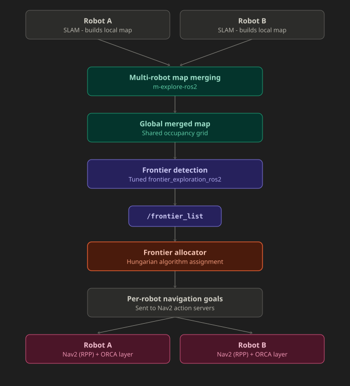

# HERMES

**H**ungarian-based **E**fficient **R**obotic **M**ulti-agent **E**xploration **S**ystem

A ROS2 multi-robot autonomous exploration stack that combines optimal frontier allocation (Hungarian algorithm) with reciprocal collision avoidance (ORCA), wrapped behind a single master launch package. Built for multi-robot exploration.

---

## Overview

HERMES coordinates multiple robots exploring an unknown environment simultaneously. Individual local maps are fused into a shared global map, frontier candidates are extracted from it, and the robot-to-frontier assignment is solved as an optimal bipartite matching problem using the **Hungarian algorithm** — so robots aren't racing for the same unexplored region or wasting time on suboptimal targets.

On top of that, a reciprocal collision-avoidance layer (**ORCA / RVO2**) handles robot-to-robot safety in real time, decoupling "who goes where" (allocation) from "how do we not collide getting there" (local avoidance) — the two problems that usually get tangled together in naive multi-robot exploration setups.

The entire pipeline — SLAM, map merging, frontier detection, allocation, collision avoidance, and navigation — is bundled behind a **single master package**, so the whole system launches with one command instead of juggling half a dozen terminals.

*Current implementation is built and validated on two robots; the allocation and avoidance layers are designed to scale to more.*

## Demo

<!-- Replace the line below with your actual video/gif once ready -->
<video src="./demo.mp4" width="100%" controls>
  Your browser does not support the video tag or cannot play this video.
</video>

## Key Features

- 🧮 **Optimal frontier allocation** — a custom Hungarian-algorithm allocator assigns robots to frontiers to minimize overlap and total travel cost across all robots, instead of greedy nearest-frontier assignment
- 🛡️ **ORCA-based collision avoidance** — reciprocal velocity obstacles (via RVO2) let robots navigate safely around each other without needing to renegotiate the entire plan on every near-encounter; the safety layer only intervenes when robots are actually on a collision course, leaving Nav2's planned trajectory untouched otherwise (implemented for multi-robot coordination)
- 🚀 **High-speed navigation** — tuned Nav2 configuration (Regulated Pure Pursuit planner, adjusted costmap inflation) for faster, smoother trajectory tracking than default settings
- 🗺️ **Merged global map** — local maps from every robot are fused into a single shared occupancy grid via multi-robot map merging
- 🎯 **Tuned frontier detection** — `frontier_exploration_ros2` configured to publish a clean, de-duplicated frontier list over the global map topic
- 📦 **One-command launch** — a master package composes every other package's launch files into a single entry point
- 📈 **Multi-robot architecture** — designed so adding more robots is a configuration change, not a redesign

## Architecture / Pipeline



**Pipeline, step by step:**

1. Each robot runs SLAM independently, building its own local map.
2. Local maps are fused into a single global map using multi-robot map merging (`m-explore-ros2`).
3. A tuned instance of `frontier_exploration_ros2` scans the merged global map and publishes a clean list of candidate frontiers on a shared topic.
4. The **frontier allocator** consumes this list and solves an optimal assignment using the **Hungarian algorithm**, deciding which robot goes to which frontier such that total system-wide cost (distance, information gain, separation) is minimized.
5. Each robot navigates to its assigned frontier using Nav2 with the **RPP (Regulated Pure Pursuit)** planner for fast, smooth motion, while an **ORCA/RVO2** local avoidance layer resolves any close-proximity conflicts between robots in real time — independent of the global allocation decision.
6. The cycle repeats until no frontiers remain.

### Why separate allocation from collision avoidance?

Bundling "which frontier does each robot go to" and "how do robots avoid each other" into a single decision tends to produce systems that are hard to tune and harder to scale. HERMES treats these as two independent layers: the Hungarian allocator solves a *global, discrete* assignment problem periodically, while ORCA solves a *local, continuous* avoidance problem every control cycle. This separation is also what makes the architecture scale reasonably as more robots are added — the allocator's cost matrix simply grows, and each robot's ORCA layer only needs to reason about nearby agents, not every robot in the system.

## Implementation Highlights

A few design details that go beyond a textbook Hungarian + ORCA integration:

- **Exploration-phase-aware cost weighting** — the allocator doesn't use static weights. Early in exploration, the cost function favors spreading robots apart and prioritizing information-rich frontier clusters (high separation and richness weighting), to maximize map coverage per unit time. Once exploration crosses a completion threshold, weighting shifts almost entirely to raw distance minimization, since the priority late-stage is mopping up remaining pockets quickly rather than optimal spread. Weights are recomputed live from the ratio of known-to-total cells in the merged occupancy grid.
- **Goal-stickiness with partial re-optimization** — rather than solving the full assignment problem from scratch every cycle (which causes goal-thrashing as marginal cost differences flip the optimal assignment), robots already within tolerance of their current target are "locked" to it, and the Hungarian solver only runs over the remaining free robots and free clusters each cycle. This keeps the allocator globally optimal for new assignments while avoiding oscillation on ones that are already good enough.
- **Union-find frontier clustering** — raw frontier points are downsampled and grouped into clusters using a disjoint-set (union-find) single-link agglomerative method before allocation, so robots are assigned to coherent unexplored *regions* rather than individual noisy points.
- **Progress-aware goal watchdog** — goals are cancelled not just on a fixed timeout, but also if a robot's distance-to-goal stops decreasing for a sustained period, catching robots that are stuck (wedged against an obstacle, oscillating) well before a long fixed timeout would.
- **Self-expiring blacklist and reached memory** — frontiers that repeatedly fail are temporarily blacklisted, and recently completed ones are temporarily excluded from re-assignment, both with TTL-based expiry so the system doesn't create permanent dead zones on the map.
- **Reactive (not continuous) ORCA intervention** — the ORCA/RVO2 safety layer only overrides Nav2's commanded velocity when robots are within a proximity-and-closing-velocity condition; otherwise Nav2's planned trajectory passes through untouched. This keeps ORCA from constantly perturbing paths that were never actually going to collide.
- **Deadlock-breaking bias** — a directional bias term is added to each robot's preferred velocity during an ORCA intervention specifically to break symmetric face-off deadlocks (robots heading straight at each other), plus a stall-recovery fallback so the safety layer can't leave a robot frozen in place.

## Repository Structure
hermes/
├── hermes_bringup/  
├── map_merge/               --> Multi-robot map merging (m-explore-ros2)
├── frontier_detector/       --> Tuned frontier_exploration_ros2 configuration
├── frontier_allocator/      --> Hungarian allocator (frontier_alg) + goal dispatch (frontier_pub)
├── orca/         --> ORCA/RVO2 bridge (orca_turtlebot_bridge_node)
├── nav2_start/              --> Nav2 params, RPP planner configuration
└── spawn_bots/       --> Robot URDF/SDF + simulation assets


## Prerequisites

- Ubuntu 22.04
- ROS2 Humble
- Gazebo (Classic or Ignition, per your setup)
- Nav2
- SLAM Toolbox
- `m-explore-ros2`
- `frontier_exploration_ros2`
- [`Python-RVO2`](https://github.com/sybrenstuvel/Python-RVO2) (built from source)

## Installation

```bash
# Clone into your workspace
cd ~/your_ws/src
git clone https://github.com/manan-iitj/hermes-ros2.git

# Install dependencies
cd ~/your_ws
rosdep install --from-paths src --ignore-src -r -y

# Build the workspace
cd ~/your_ws
colcon build --symlink-install
source install/setup.bash
```

## Usage

Launch the entire system -- simulation, SLAM, map merging, frontier detection, allocation, collision avoidance, and navigation -- with a single command:

```bash
ros2 launch hermes_bringup hermes.launch.py
```

## Acknowledgments

- [`m-explore-ros2`](https://github.com/robo-friends/m-explore-ros2) for multi-robot map merging
- [`frontier_exploration_ros2`](https://github.com/) for frontier detection groundwork
- [`Python-RVO2`](https://github.com/sybrenstuvel/Python-RVO2) for the ORCA/RVO2 implementation
- The Nav2 and SLAM Toolbox communities